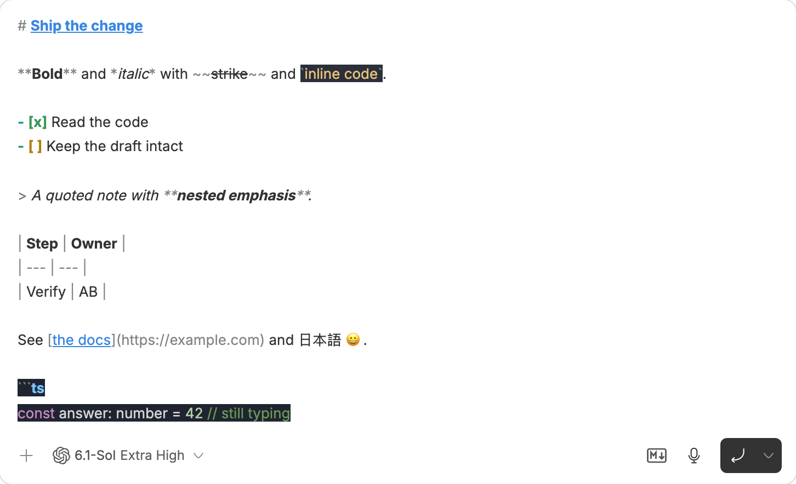
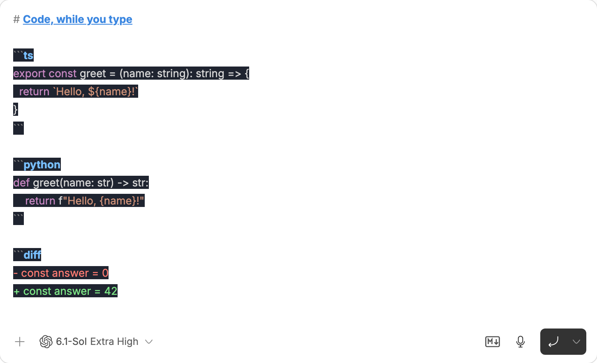

# MD Prompt for BB

[](https://github.com/AdzeB/bb-plugin-md-prompt/actions/workflows/ci.yml)
[](https://github.com/AdzeB/bb-plugin-md-prompt/releases)
[](LICENSE)

Live Markdown and syntax highlighting in BB's prompt composer, based on
[nogu66/md-prompt](https://github.com/nogu66/md-prompt).

Type or paste Markdown and it is painted as you go. Headings, bold, italics,
strikethrough, inline code, lists, tasks, quotes, tables and links are styled.
Code fences get syntax colours from the opening fence, including while the
fence is still unfinished. Markdown markers stay visible. The prompt sent to
the agent is exactly the text you typed.

Works with BB's native composer across agent providers. No Claude Code
installation, API key, remote service or agent turn is needed.



## Install

Requires BB >=0.47 with Plugin SDK >=0.6.79 <0.7.

```sh
bb plugin install 'git:https://github.com/AdzeB/bb-plugin-md-prompt.git@^0.1.0'
```

After installation, the Markdown icon appears beside the composer controls.
Click it to turn highlighting on or off. Compact composers show the same
control above the input. The setting is also available in BB's installed
plugin settings as **Markdown highlighting**. Changes apply immediately to
open composers and are saved across sessions.

```sh
bb md-prompt status
bb md-prompt on
bb md-prompt off
bb md-prompt toggle
bb md-prompt status --json
```

The BB CLI commands replace upstream's `/md-prompt` slash command.

Update an existing managed install with `bb plugin update md-prompt`.
See [GitHub Releases](https://github.com/AdzeB/bb-plugin-md-prompt/releases) and
[CHANGELOG.md](CHANGELOG.md) for version history.



## How it works

The unchanged upstream MIT-licensed parser produces style runs. `paint.ts`
resolves overlapping runs with the original last-run-wins order and maps them
to BB's public `composer.customize().richText.effects` API. Parsing is cached
for up to four drafts and never sent to the server. The backend stores only
the enabled setting.

The native editor owns typing, selection, IME composition, mention pills,
attachments, undo and submission. The plugin never replaces the editor,
rewrites the draft, installs keyboard handlers or touches the send path.
Styles avoid changing font size, line height or character spacing.

## Limits

- Drafts over 60,000 UTF-16 code units are left unpainted.
- Code backgrounds cover text, with gaps on empty lines.
- The original parser's Markdown rules and language support are retained.
  Math, YAML front matter, callout syntax and embedded HTML script/style
  highlighting are outside its supported syntax.
- Colours inside code use the upstream fixed dark card on light and dark
  themes. Markdown marker dimming uses CSS opacity in BB.
- Requires a composer renderer that implements BB's rich-text effects and
  customization slots. The installed native BB composer is verified.
- The on/off preference is global to the BB installation.

## Development and verification

```sh
npm ci --ignore-scripts
npm run check
npm run build
bb plugin install .
bb plugin dev
```

The E2E runner uses a separate, headless Chromium profile against a running
BB. It never submits a prompt. It saves composer-only screenshots and `results.json` in `artifacts/e2e/`
or `MD_PROMPT_REPORT_DIR`. Project lists and the app sidebar are outside the
capture. Traces are off by default. Opt in locally with `MD_PROMPT_TRACE=1`;
a trace can contain private app-shell data and must not be published.

```sh
npx playwright install chromium
npm run verify:e2e
```

Run it inside BB to inherit the correct `BB_SERVER_URL`, or set the URL of
your installation. In a macOS sandbox, the browser may need permission to
launch outside the sandbox. It remains headless and isolated.

See [docs/verification.md](docs/verification.md) for the failure cases. The
upstream revision and attribution are recorded in
[THIRD_PARTY_NOTICES.md](THIRD_PARTY_NOTICES.md).

See [CONTRIBUTING.md](CONTRIBUTING.md) for development and release steps.
